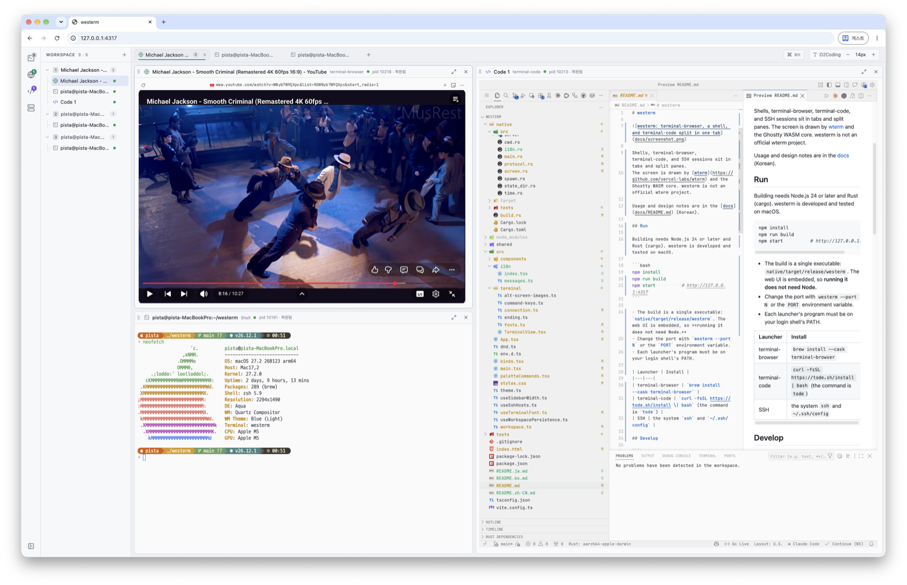

# westerm

**We**b **S**ession **Term**inal。ウィンドウを閉じても、プログラムを再起動しても、再起動後もセッションが残る Web ターミナルです。

[English](README.md) · [한국어](README.ko.md) · **日本語** · [中文](README.zh-CN.md)



シェル、terminal-browser、terminal-code、SSH をタブと分割パネルに配置します。
画面は [wterm](https://github.com/vercel-labs/wterm) と Ghostty WASM コアで描画します。westerm は wterm の公式プロジェクトではありません。

使い方と構成は[ドキュメント](docs/README.md)(韓国語)にあります。

## 実行

ビルドには Node.js 24 以上と Rust(cargo)が必要です。macOS で開発・テストしています。

```bash
npm install
npm run build
npm start          # http://127.0.0.1:4317
```

- ビルド結果は実行ファイル 1 つです: `native/target/release/westerm`。Web 画面を内蔵しているので、**実行に Node は不要です。**
- ポートは `westerm --port N` または環境変数 `PORT` で変更します。
- 各ランチャーのプログラムがログインシェルの PATH にある必要があります。

| ランチャー | インストール |
|---|---|
| terminal-browser | `brew install --cask terminal-browser` |
| terminal-code | `curl -fsSL https://tode.sh/install \| bash`(コマンド名は `tode`) |
| SSH | システムの `ssh` と `~/.ssh/config` |

## 開発

```bash
npm run dev:server   # Rust サーバー (:4317)、Vite のオリジンを許可
npm run dev          # Vite HMR (:5173)、/api と /ws を :4317 へ転送

npm test             # 画面のテスト(node:test)+ Rust のテスト(cargo test)
npm run type-check
```

| パス | 内容 |
|---|---|
| `src/` | 画面 (React + wterm) |
| `src/i18n/` | 画面の文言 (한국어, English, 日本語, 中文) |
| `shared/` | プロトコルの型、レイアウトツリー、保存形式 |
| `native/src/server/` | ダッシュボードサーバー (axum) |
| `native/src/host/` | PTY ホスト: シェルの維持、画面の保存と復元 |

PTY ホストのコードを変更すると、実行中のシェルが一度「復元済み」として再起動します。詳しくは[セッションの維持](docs/sessions.md)(韓国語)を参照してください。

## コントリビュート

- バグや提案は [Issues](https://github.com/SteelCrab/westerm/issues) へ。
- PR の前に `npm test` と `npm run type-check` を通してください。
- 開発環境、ルール、翻訳の方法は [CONTRIBUTING.md](CONTRIBUTING.md)(英語)を参照してください。
- セキュリティの問題は公開 Issue ではなく[非公開の脆弱性報告](https://github.com/SteelCrab/westerm/security/advisories/new)で知らせてください。
