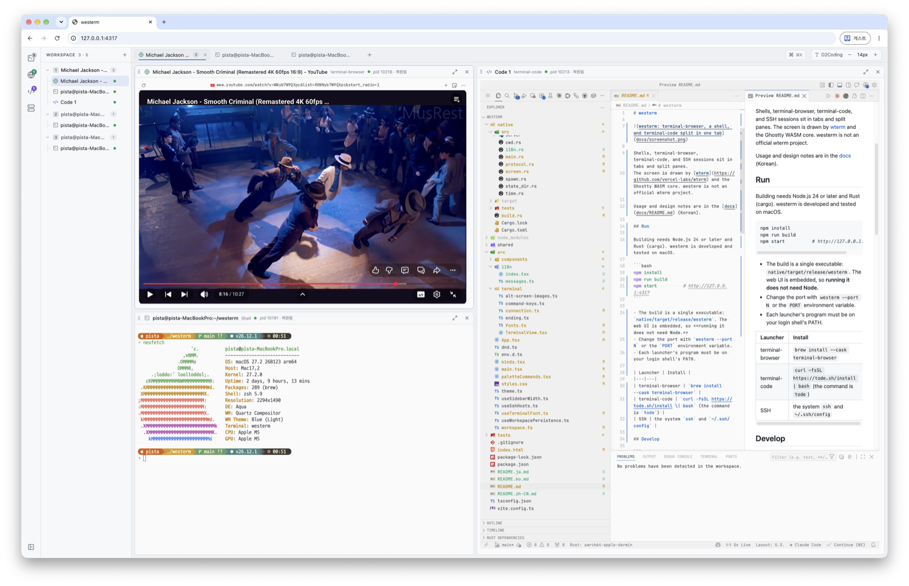

# westerm

**We**b **S**ession **Term**inal. 창을 닫아도, 프로그램을 다시 켜도, 재부팅해도 세션이 남는 웹 터미널입니다.

[English](README.md) · **한국어** · [日本語](README.ja.md) · [中文](README.zh-CN.md)



셸, terminal-browser, terminal-code, SSH를 탭과 분할 패널로 배치합니다.
화면은 [wterm](https://github.com/vercel-labs/wterm)과 Ghostty WASM 코어로 그립니다. westerm은 wterm 공식 프로젝트가 아닙니다.

사용법과 구조는 [문서](docs/README.md)에 있습니다.

## 실행

빌드에는 Node.js 24 이상과 Rust(cargo)가 필요합니다. macOS에서 개발하고 시험했습니다.

```bash
npm install
npm run build
npm start          # http://127.0.0.1:4317
```

- 빌드 결과는 실행 파일 하나입니다: `native/target/release/westerm`. 웹 화면이 들어 있어서 **실행에는 Node가 필요 없습니다.**
- 포트는 `westerm --port N` 또는 `PORT` 환경 변수로 바꿉니다.
- 아이콘별 프로그램이 로그인 셸의 PATH에 있어야 합니다.

| 아이콘 | 설치 |
|---|---|
| terminal-browser | `brew install --cask terminal-browser` |
| terminal-code | `curl -fsSL https://tode.sh/install \| bash` (명령 이름 `tode`) |
| SSH | 시스템 `ssh`와 `~/.ssh/config` |

## 개발

```bash
npm run dev:server   # Rust 서버 (:4317), Vite 주소를 허용 출처로 추가
npm run dev          # Vite HMR (:5173), /api와 /ws를 :4317로 전달

npm test             # 화면 테스트(node:test) + Rust 테스트(cargo test)
npm run type-check
```

| 경로 | 내용 |
|---|---|
| `src/` | 화면 (React + wterm) |
| `src/i18n/` | 화면 문구 (한국어, English, 日本語, 中文) |
| `shared/` | 프로토콜 타입, 레이아웃 트리, 저장 형식 |
| `native/src/server/` | 대시보드 서버 (axum) |
| `native/src/host/` | PTY 호스트: 셸 유지, 화면 저장·복원 |

PTY 호스트 코드를 바꾸면 실행 중인 셸이 한 번 `복원됨`으로 다시 시작합니다. 자세한 내용은 [세션 유지](docs/sessions.md)를 보세요.

## 기여

- 버그와 제안은 [Issues](https://github.com/SteelCrab/westerm/issues)에 올려 주세요.
- PR 전에 `npm test`와 `npm run type-check`를 통과시켜 주세요.
- 개발 준비, 규칙, 번역 방법은 [기여 안내](CONTRIBUTING.ko.md)를 보세요.
- 보안 문제는 공개 이슈 대신 [비공개 취약점 제보](https://github.com/SteelCrab/westerm/security/advisories/new)로 알려 주세요.
