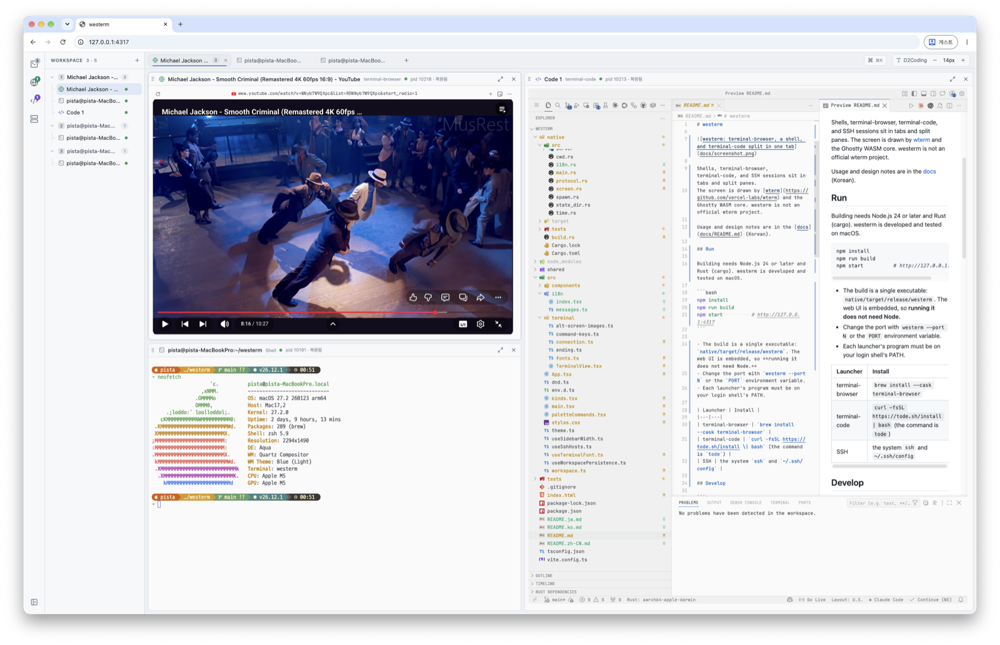

# westerm

**We**b **S**ession **Term**inal. A web terminal whose sessions survive closing the window, restarting the program, and rebooting.

**English** · [한국어](README.ko.md) · [日本語](README.ja.md) · [中文](README.zh-CN.md)




## Install

### Desktop app (recommended)

The easiest way to install. Download the file for your system and open it. You do not need a terminal, Node.js, or Rust.

| System | Download | Install |
|---|---|---|
| macOS | [`westerm-macos-app.dmg`](https://github.com/SteelCrab/westerm/releases/latest/download/westerm-macos-app.dmg) | Open it and drag **westerm** onto the Applications folder. |
| Windows | [`westerm-windows-app-setup.exe`](https://github.com/SteelCrab/westerm/releases/latest/download/westerm-windows-app-setup.exe) | Run the file. |
| Linux x64 | [`.deb`](https://github.com/SteelCrab/westerm/releases/latest/download/westerm-linux-app-amd64.deb) · [`.rpm`](https://github.com/SteelCrab/westerm/releases/latest/download/westerm-linux-app-x86_64.rpm) | Install the package. |
| Linux arm64 | [`.deb`](https://github.com/SteelCrab/westerm/releases/latest/download/westerm-linux-app-arm64.deb) · [`.rpm`](https://github.com/SteelCrab/westerm/releases/latest/download/westerm-linux-app-aarch64.rpm) | Install the package. |

Then open **westerm**. The dashboard opens in its own window.

- macOS blocks the first open. Allow it once in System Settings ▸ Privacy & Security ▸ Open Anyway.
- Windows SmartScreen may ask once. Choose More info ▸ Run anyway.

More about the app: [docs/install.md](docs/install.md#desktop-app).

### Command line

These install the `westerm` command, without the app window. Use them on a server, or when you prefer a terminal.

#### npm

Requires Node.js 22 or later.

```bash
npm install -g @pistacrab/westerm
```

Or run `npx @pistacrab/westerm`. Update the npm installation with `npm install -g @pistacrab/westerm@latest`.

#### pnpm

Requires Node.js 22 or later.

```bash
pnpm add -g @pistacrab/westerm
```

Or run `pnpm dlx @pistacrab/westerm`. Update with `pnpm add -g @pistacrab/westerm@latest`. pnpm installs a new release only after it is one day old (its `minimumReleaseAge` setting); to install it sooner, name the version: `pnpm add -g @pistacrab/westerm@X.Y.Z`.

#### Bun

```bash
bun add -g @pistacrab/westerm
```

This installs the same npm package. The installed `westerm` command starts through Node.js 22 or later. Without Node.js, run `bunx @pistacrab/westerm`. Update with `bun add -g @pistacrab/westerm@latest`.

#### Cargo

Requires a current stable Rust toolchain and a C compiler/linker.

```bash
cargo install westerm --locked
```

The crate includes the web UI and does not need Node.js. Update with the same command.

See [Cargo requirements and Windows limitations](docs/install.md#cargo).

#### Install script

macOS and Linux:

```bash
curl -fsSL https://raw.githubusercontent.com/SteelCrab/westerm/main/install.sh | sh
```

Windows (PowerShell):

```powershell
irm https://raw.githubusercontent.com/SteelCrab/westerm/main/install.ps1 | iex
```

Other ways to install: [docs/install.md](docs/install.md).

## Run

Desktop app: open **westerm**.

Command line:

```bash
westerm
```

Then open http://127.0.0.1:4317.

- `westerm stop`: save every session and stop.
- `westerm update`: install the newest release.
- `westerm --port 4318`: use another port.

How to use the screen: [docs/usage.md](docs/usage.md).

## Contribute

Report bugs and ideas in [Issues](https://github.com/SteelCrab/westerm/issues). Read [CONTRIBUTING.md](CONTRIBUTING.md) before a pull request.

westerm is under the [MIT License](LICENSE).
