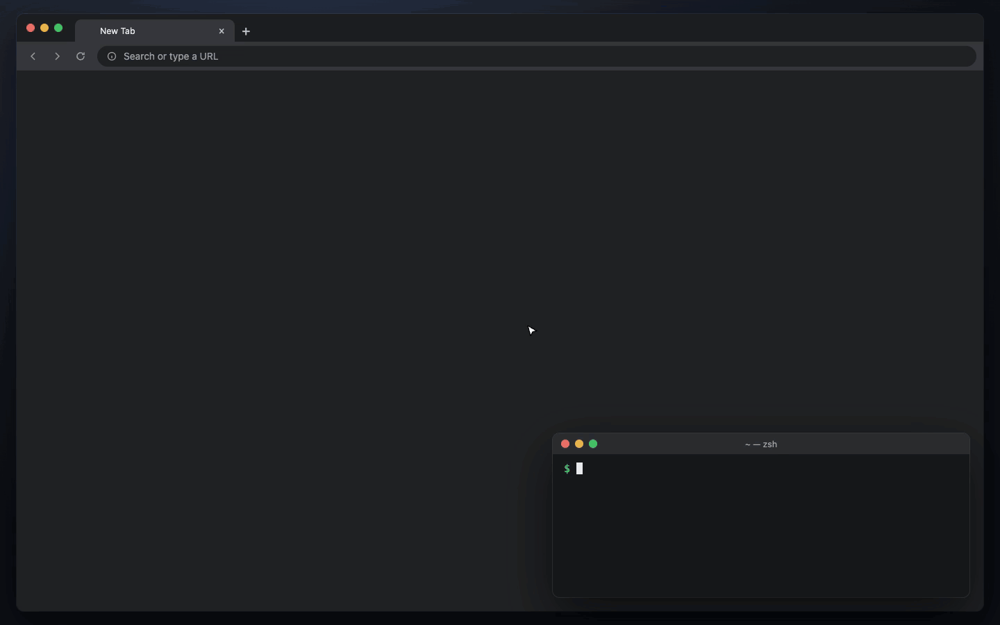

# westerm

**We**b **S**ession **Term**inal. A web terminal whose sessions survive closing the window, restarting the program, and rebooting.

**English** · [한국어](README.ko.md) · [日本語](README.ja.md) · [中文](README.zh-CN.md)



## Install

macOS and Linux:

```bash
curl -fsSL https://raw.githubusercontent.com/SteelCrab/westerm/main/install.sh | sh
```

Windows (PowerShell):

```powershell
irm https://raw.githubusercontent.com/SteelCrab/westerm/main/install.ps1 | iex
```

macOS app: download `westerm-macos-app.zip` from [Releases](https://github.com/SteelCrab/westerm/releases/latest), unzip it, and move **westerm.app** to Applications.

Other ways, and how to allow the app's first open on macOS: [docs/install.md](docs/install.md).

## Run

```bash
westerm
```

Then open http://127.0.0.1:4317.

- `westerm stop`: save every session and stop.
- `westerm update`: install the newest release.
- `westerm --port 4318`: use another port.

How to use the screen: [docs/usage.md](docs/usage.md).

## Contribute

Report bugs and ideas in [Issues](https://github.com/SteelCrab/westerm/issues). Read [CONTRIBUTING.md](CONTRIBUTING.md) before a pull request.

westerm is under the [MIT License](LICENSE).
