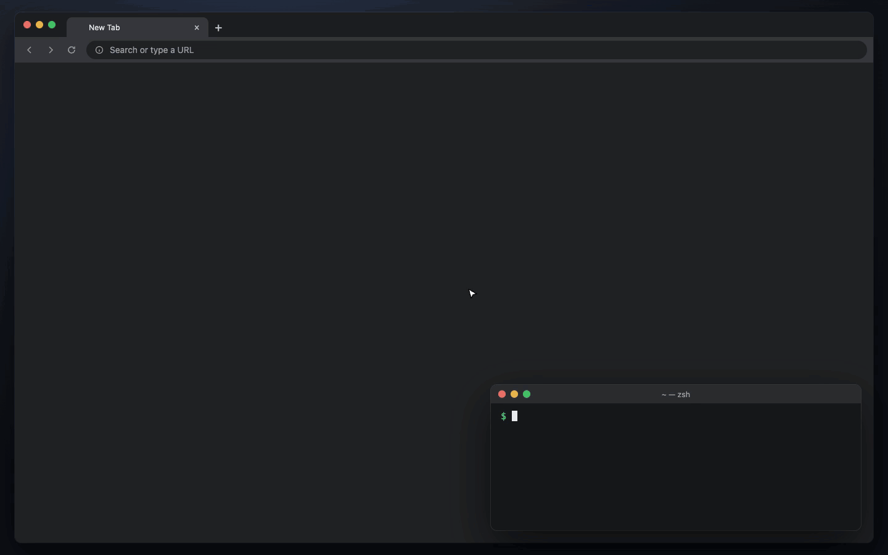
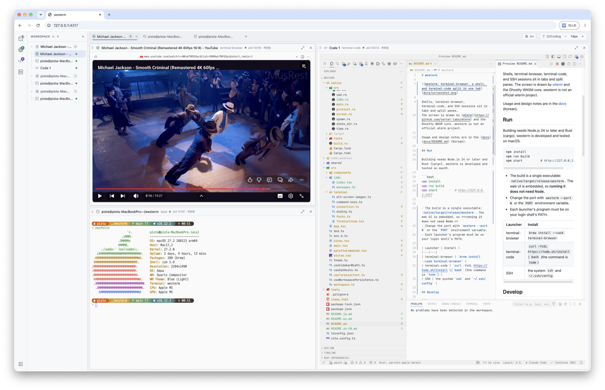

# westerm

**We**b **S**ession **Term**inal。关闭窗口、重启程序、重启电脑之后，会话依然保留的 Web 终端。

[English](README.md) · [한국어](README.ko.md) · [日本語](README.ja.md) · **中文**





## 安装

macOS、Linux：

```bash
curl -fsSL https://raw.githubusercontent.com/SteelCrab/westerm/main/install.sh | sh
```

Windows（PowerShell）：

```powershell
irm https://raw.githubusercontent.com/SteelCrab/westerm/main/install.ps1 | iex
```

macOS、Windows、Linux 桌面应用请从 [Releases](https://github.com/SteelCrab/westerm/releases/latest) 下载：

- macOS：打开 `westerm-macos-app.dmg`，把 **westerm** 拖到“应用程序”文件夹。
- Windows：运行 `westerm-windows-app-setup.exe`。
- Linux：安装 `westerm-linux-app-<arch>.deb` 或 `.rpm`。

其他安装方式，以及在 macOS 上允许应用首次打开的方法：[docs/install.md](docs/install.md)（英语）

## 运行

```bash
westerm
```

然后打开 http://127.0.0.1:4317。

- `westerm stop`：保存所有会话并停止。
- `westerm update`：安装最新版本。
- `westerm --port 4318`：使用其他端口。

界面用法：[docs/usage.md](docs/usage.md)（英语）

## 贡献

请在 [Issues](https://github.com/SteelCrab/westerm/issues) 中报告问题和建议。提交 PR 前请阅读 [CONTRIBUTING.md](CONTRIBUTING.md)（英语）。

westerm 以 [MIT 许可证](LICENSE)发布。
